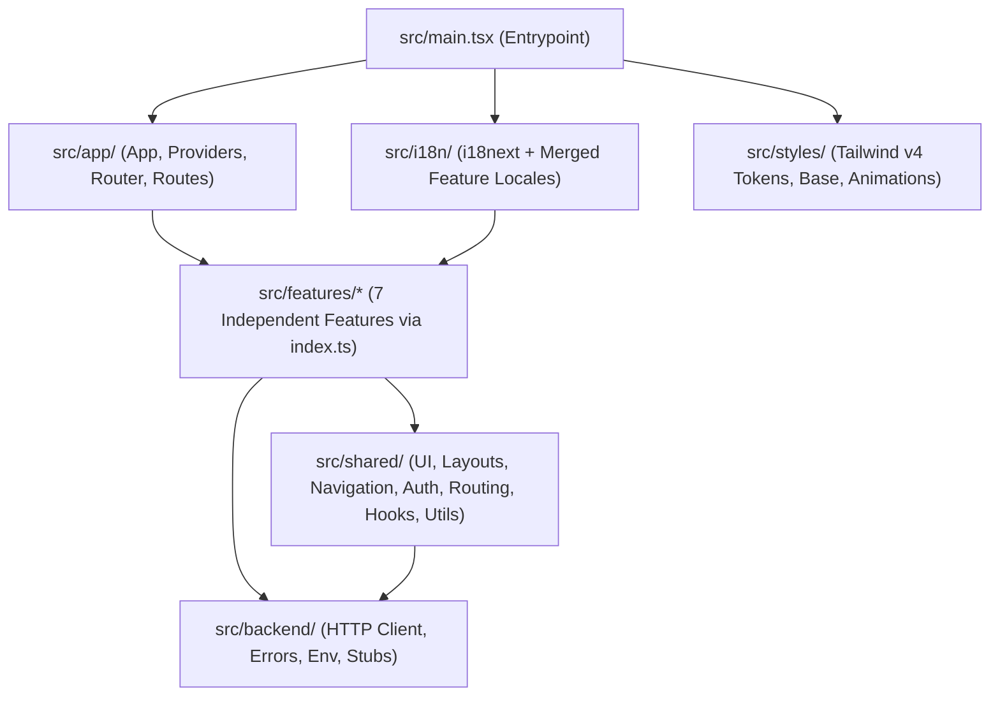

# InternsHub Frontend

**InternsHub** is a bilingual (English LTR & Arabic RTL) web platform designed to bridge the gap between university learning and a real tech career. It connects learners, mentors, senior engineers, and hiring employers in a single experience covering structured courses, squad-based internships, 1-on-1 mentorship, AI-assisted onboarding assessments, and talent recruitment.

This repository contains the **InternsHub Frontend** built with **React 19**, **TypeScript (strict mode)**, **Vite 8**, **Tailwind CSS v4**, **React Router v6**, and **i18next**. It is structured as a modular, team-ready foundation so seven developers can work in parallel across seven clearly bounded feature modules.

---

## Table of Contents

- [A. Project Introduction](#a-project-introduction)
- [B. Platform Features Overview](#b-platform-features-overview)
- [C. Technology Stack](#c-technology-stack)
- [D. Prerequisites](#d-prerequisites)
- [E. Installation & First Run](#e-installation--first-run)
- [F. Available Scripts](#f-available-scripts)
- [G. Project Architecture](#g-project-architecture)
- [H. The Seven Feature Modules](#h-the-seven-feature-modules)
- [I. Routing System](#i-routing-system)
- [J. Shared Components & Reusable Code](#j-shared-components--reusable-code)
- [K. Styling & Design System](#k-styling--design-system)
- [L. Internationalization (English & Arabic)](#l-internationalization-english--arabic)
- [M. Backend Integration Foundation](#m-backend-integration-foundation)
- [N. Environment Variables](#n-environment-variables)
- [O. Git Workflow & Team Collaboration](#o-git-workflow--team-collaboration)
- [P. Team Ownership & File Boundaries](#p-team-ownership--file-boundaries)
- [Q. How to Add or Modify Functionality](#q-how-to-add-or-modify-functionality)
- [R. Coding Standards](#r-coding-standards)
- [S. Testing & Validation](#s-testing--validation)
- [T. Common Problems & Troubleshooting](#t-common-problems--troubleshooting)
- [U. Deployment Overview](#u-deployment-overview)
- [V. Documentation Map](#v-documentation-map)
- [W. Developer Onboarding Checklist](#w-developer-onboarding-checklist)

---

## A. Project Introduction

### What InternsHub Is & The Problem It Solves

Many students graduate with theoretical knowledge but lack practical team experience, code review exposure, mentorship, and structured pathways into entry-level tech jobs. InternsHub solves this by guiding learners through a structured journey:

1. **Discover** tracks, packages (3-, 6-, and 12-month paths), and senior mentors.
2. **Sign up & Onboard** via account verification, profile setup, package/track selection, CV upload, payment checkout, and an AI-assisted technical assessment interview.
3. **Learn & Build** through curated track courses and a senior-led internship squad using sprint boards and real project reviews.
4. **Get Mentored** by booking 1-on-1 mentorship sessions and communicating with mentors.
5. **Get Hired** by opting into the talent directory, tracking recruitment applications, scheduling employer interviews, and reviewing agreements.

### Target Users

| Role (`UserRole`) | Primary Experience |
|---|---|
| **Student / Learner (`student`)** | Public discovery, authentication, onboarding, student dashboard, courses, squad internship workspace, mentorship booking & chat, student recruitment portal |
| **Employer / Hiring Partner (`employer`)** | Role-restricted employer recruitment portal (`/employer/*`): talent directory, shortlists, candidate pipeline, interview scheduling, hiring decisions, and partner agreements |
| **Mentor / Senior (`mentor`, `senior`)** | Represented in public senior profiles, squad leadership, and mentorship booking flows (dedicated mentor/senior portals are not yet implemented in this frontend) |
| **Admin (`admin`)** | Permitted alongside `employer` on `/employer/*` role-guarded routes |

### Frontend vs. Backend Responsibilities

- **Frontend (this repository):** Renders all UI views, handles client-side routing, validates form inputs, manages UI state and bilingual LTR/RTL presentation, enforces client-side route guards, and isolates all server communication behind typed service functions in `src/features/<feature>/services/` and `src/backend/`.
- **Backend (external API — not yet connected):** Owns authentication sessions, user accounts, verification codes, enrollments, payments (e.g., checkout initiation/verification), CV storage/parsing, AI interview scoring, squad assignment, mentorship slot booking, and recruitment records.

> **Current Integration Status:** The frontend is intentionally prepared in **backend-disconnected mode** until the new backend API is deployed. Service stubs in `authentication`, `onboarding`, `courses`, `internships`, and `mentorship` fail explicitly with `BackendNotConnectedError` rather than faking backend success. `landing` uses static showcase data, and `recruitment` currently reads local in-memory/JSON fixtures for UI development.

---

## B. Platform Features Overview

The platform is organized into **exactly seven official feature modules** under `src/features/`:

| # | Feature | Location | Purpose & What Users Can Do | Current Status & Relationships |
|---|---|---|---|---|
| 1 | **Landing Page** | `src/features/landing/` | Public marketing homepage, internship track showcase, track detail pages, and senior mentor journey pages | Implemented UI backed by static showcase data (`data/`). Links visitors into Authentication (`/auth`, `/register`) and Onboarding/Dashboard when signed in. |
| 2 | **Authentication** | `src/features/authentication/` | Sign in, register, email confirmation resend, 3-step forgot-password recovery, phone OTP login UI, and OAuth callback handling | Preserved UI with Zod + React Hook Form validation. Service calls in `authService.ts` throw `BackendNotConnectedError` until backend auth endpoints are wired. Exports `ResendConfirmation` for `onboarding`. |
| 3 | **Onboarding** | `src/features/onboarding/` | 10-step learner setup flow: Account, Verify (Email/Phone/National ID card), Profile, Path (Package + Track + Policy Consent), CV Upload & CV Review, Payment Checkout, AI Interview Setup & 3D Avatar Call Stage, Assessment Results, Squad Status, and Mentorship Intro | Full multi-step UI + 3D Three.js avatar interviewer preserved. Supports local dev preview navigation across steps 02–10 without faking backend mutations. Uses `ResendConfirmation` from `authentication`. |
| 4 | **Recruitment** | `src/features/recruitment/` | Two portals: Student recruitment workflow (`/recruitment/*`: eligibility, profile, opportunities, talent-directory consent, applications, interviews, agreements, notifications, completion) and Employer portal (`/employer/*`: pipeline, talent search, candidate profiles, shortlists, interview scheduling, hiring decisions, agreements) | Preserved UI currently backed by local JSON/in-memory fixture stores in `src/features/recruitment/data/` until connected to `src/backend/`. Employer routes require `RoleRoute` (`employer` or `admin`). |
| 5 | **Courses** | `src/features/courses/` | Student course catalog (`/dashboard/courses`), plan upgrade views (`/dashboard/courses/plans`), and standalone course detail, video player, and quiz screens (`/courses/:id/*`) | Preserved UI combining catalog data (`coursesCatalog.ts`) with backend service stubs (`coursesService.ts` -> `BackendNotConnectedError`). Mounts inside `StudentLayout` under `/dashboard`. |
| 6 | **Internships** | `src/features/internships/` | Student Dashboard Home (`/dashboard`), Internship Journey Dashboard (`/dashboard/internship`), and Squad Project & Sprint Kanban workflow (`/dashboard/internship/project/*`: details, review, done, completed, final-review, results) | Preserved UI with stage-based views and project workflow pages. Backend data/mutations in `internshipsService.ts` throw `BackendNotConnectedError`. Mounts inside `StudentLayout` under `/dashboard`. |
| 7 | **Mentorship** | `src/features/mentorship/` | 9-screen 1-on-1 mentorship booking & session management workspace (`/mentorship/*`) plus Mentor Chat (`/dashboard/chat`) | Preserved UI wrapped in `MentorshipShell` & `MentorshipContext`. In local dev without a backend, enters honest empty preview mode so all 9 routes render without blocking; booking/cancellation mutations throw `BackendNotConnectedError`. |

---

## C. Technology Stack

All versions below match [package.json](package.json):

| Technology | Version | Purpose in This Project |
|---|---|---|
| **React** & **React DOM** | `19.2.0` | Component-based UI library driving all views, contexts, and lazy-loaded routes |
| **TypeScript** | `~6.0.2` | Static type safety across components, route contracts, and backend DTOs (strict mode enabled) |
| **Vite** | `8.3.0` | Fast development server with Hot Module Replacement (HMR), optional `/api` dev proxy, and optimized production bundler |
| **@vitejs/plugin-react** | `6.1.1` | Fast Refresh and modern JSX transform for React in Vite |
| **Tailwind CSS** (`tailwindcss`, `@tailwindcss/vite`, `@tailwindcss/postcss`) | `4.3.3` | Utility-first CSS framework using CSS-first `@theme` design tokens in `src/styles/tokens.css` |
| **React Router DOM** | `6.30.6` | Client-side routing via `createBrowserRouter` with nested layouts, route handles, lazy loading, and v7 future flags |
| **React Hook Form** | `7.90.0` | Performant uncontrolled form state management with minimal re-renders |
| **Zod** & **@hookform/resolvers** | `4.6.7` / `5.9.2` | Schema-based client-side form validation (used in authentication, onboarding, etc.) |
| **i18next** & **react-i18next** | `26.4.5` / `17.0.17` | Bilingual localization (English LTR and Arabic RTL) with per-feature locale namespaces |
| **Radix UI** (`radix-ui`) | `1.8.1` | Accessible headless primitives (e.g., dialogs, menus, popovers) |
| **Lucide React** | `1.57.0` | Consistent SVG icon library |
| **date-fns** | `4.4.0` | Date formatting and manipulation utilities |
| **Three.js** (`three`, `@types/three`) | `0.170.0` | 3D WebGL rendering for the onboarding AI interviewer avatar (`src/features/onboarding/ai-interviewer/`) |
| **@fontsource-variable/plus-jakarta-sans** | `5.3.0` | Self-hosted variable Plus Jakarta Sans font loaded in `src/main.tsx` |
| **Oxlint** | `1.81.0` | Fast JavaScript/TypeScript static linter (`npm run lint` runs `oxlint src`) |
| **Autoprefixer** & **PostCSS** | `10.6.1` / `8.5.30` | CSS vendor-prefixing and build processing support |

### Why These Core Choices Matter

- **Vite 8 + Lazy Routes:** Keeps dev startup under ~1 second and splits heavy modules (like `three` and locale bundles) into separate production chunks.
- **Tailwind CSS v4 (`@theme`):** Eliminates legacy JS config files; design tokens live directly in CSS custom properties (`src/styles/tokens.css`) and automatically generate utility classes like `bg-brand-primary` and `text-ink`.
- **React Hook Form + Zod:** Keeps complex multi-field forms (registration, password recovery, onboarding profile) strongly typed and validated without boilerplate state.
- **Oxlint + Strict `tsc`:** Catches unused locals/parameters, type mismatches, and common React bugs in milliseconds.

---

## D. Prerequisites

Before installing the project, make sure you have:

- **Node.js:** `^20.19.0` or `>=22.12.0` (required by Vite `8.3.x`, verified from `node_modules/vite/package.json`). Check with `node -v`.
- **npm:** Bundled with Node.js (npm 10+ recommended). Check with `npm -v`.
- **Git:** Any recent version supporting `git switch` (Git 2.23+). Check with `git --version`.
- **Code Editor:** **VS Code** (recommended).
- **Recommended VS Code Extensions:**
  - **Tailwind CSS IntelliSense** (`bradlc.vscode-tailwindcss`) — autocomplete and CSS v4 `@theme` recognition
  - **Oxc / Oxlint** (`oxc.oxc-vscode`) — inline lint diagnostics matching `npm run lint`
  - **Pretty TypeScript Errors** (optional) — more readable strict TypeScript hints
- **Local Environment File:** A local `.env.local` copied from [`.env.example`](.env.example) (never committed to Git).

---

## E. Installation & First Run

Follow these steps from your terminal:

```bash
# 1. Clone the repository
git clone https://github.com/spacetechcoacademy-cmyk/internshub-frontend.git

# 2. Enter the project folder
cd internshub-frontend

# 3. Switch to the shared development branch (never develop directly on main)
git switch dev

# 4. Pull the latest changes from origin/dev
git pull --ff-only origin dev

# 5. Install all dependencies from package-lock.json
npm install

# 6. Create your local environment file from the template
# macOS / Linux / Git Bash:
cp .env.example .env.local
# Windows PowerShell:
# Copy-Item .env.example .env.local

# 7. Start the local Vite development server
npm run dev
```

8. Open **`http://localhost:5173`** in your browser.

### What Each Step Does

- `git switch dev` & `git pull --ff-only origin dev`: Ensures you start from the latest team integration branch without accidentally creating a merge commit.
- `npm install`: Downloads all libraries listed in [package.json](package.json) into `node_modules/` (gitignored).
- `cp .env.example .env.local`: Creates your personal environment file. `.env.local` is ignored by Git via `*.local` in [`.gitignore`](.gitignore). **Never commit `.env` or `.env.local`.**
- `npm run dev`: Starts Vite with Hot Module Replacement (HMR) so edits refresh automatically in the browser.

> **Viewing Protected Pages Locally:** By default, protected routes (`/dashboard`, `/onboarding`, `/mentorship`, `/recruitment`, `/employer`) redirect anonymous visitors to `/auth`. To preview protected UI screens locally while no backend is connected, uncomment `VITE_DEV_BYPASS_AUTH=true` in `.env.local` and restart `npm run dev`. See [Section N](#n-environment-variables) for full rules and security safeguards.

---

## F. Available Scripts

All scripts are defined in [package.json](package.json):

| Command | Underlying Script | What It Does | When to Use |
|---|---|---|---|
| `npm run dev` | `vite` | Starts the local dev server at `http://localhost:5173` with HMR | Daily local development |
| `npm run typecheck` | `tsc --noEmit` | Runs strict TypeScript compiler checks across `src/` and `vite.config.ts` without emitting JS | Before every commit and after refactoring types |
| `npm run lint` | `oxlint src` | Runs Oxlint static analysis across all files in `src/` | Before every commit to verify 0 errors & 0 warnings |
| `npm run build` | `tsc --noEmit && vite build` | Type-checks the codebase and builds the optimized production bundle into `dist/` | Before pushing a branch or opening a PR |
| `npm run preview` | `vite preview` | Serves the built `dist/` folder locally to test production behavior | When verifying production bundles (e.g., confirming dev bypass is stripped) |

---

## G. Project Architecture

InternsHub uses a **Feature-Sliced Modular Architecture** with strict unidirectional dependencies:



### Actual Repository Directory Tree

```text
internshub-frontend/
├── index.html                   # HTML shell, Google Fonts (Plus Jakarta Sans, Cairo, Inter, Moul, Poppins)
├── package.json                 # Dependencies and npm scripts
├── tsconfig.json                # Strict TypeScript config + `@/*` -> `./src/*` path alias
├── vite.config.ts               # Vite plugins, `/api` dev proxy, `__API_PROXY_ACTIVE__`, manualChunks
├── vercel.json                  # SPA catch-all rewrite to `/index.html`
├── .env.example                 # Documented environment variable template
├── .gitignore                   # Ignores node_modules, dist, .env*, *.local, .vscode/*
├── README.md                    # This complete developer guide
├── ARCHITECTURE.md              # Architecture & boundary rules
├── BACKEND_INTEGRATION_GUIDE.md # Backend integration contract & checklist
├── DEVELOPMENT_GUIDELINES.md    # Coding, TypeScript & PR standards
├── ROUTING_GUIDELINES.md        # Routing conventions & guard rules
├── SHARED_COMPONENTS_GUIDE.md   # Shared UI, layout & navigation reference
├── STYLING_GUIDELINES.md        # Tailwind v4 tokens & RTL/LTR styling guide
├── TEAM_WORKFLOW.md             # Git branching, ownership & PR workflow
└── src/
    ├── main.tsx                 # Loads font, i18n, global CSS, mounts <App />
    ├── vite-env.d.ts            # Typed `ImportMetaEnv` + `__API_PROXY_ACTIVE__`
    ├── app/                     # Composition root (4 files)
    │   ├── App.tsx              # <AppProviders> + <RouterProvider>
    │   ├── providers.tsx        # Root React providers (<AuthProvider>)
    │   ├── router.tsx           # Composes createBrowserRouter from the 7 feature barrels
    │   └── routes.ts            # Canonical ROUTES, EMPLOYER_ROUTES & typed path builders
    ├── backend/                 # UI-agnostic API boundary (9 files)
    │   ├── index.ts             # Public barrel (`@/backend`)
    │   ├── README.md            # Backend layer guide
    │   ├── config/env.ts        # BACKEND_CONFIG, isBackendConfigured, isApiProxyConfigured
    │   ├── client/httpClient.ts # httpRequest<T>, timeout, AbortSignal, interceptors
    │   ├── client/errors.ts     # BackendError, BackendNotConnectedError, BackendTimeoutError
    │   ├── services/index.ts    # notConnected() helper for feature stubs
    │   ├── endpoints/index.ts   # Future endpoint registry placeholder
    │   ├── adapters/index.ts    # DtoAdapter & adaptList utilities
    │   └── types/common.ts      # RequestConfig, ApiErrorPayload, ApiResponse, PaginatedResult
    ├── i18n/                    # Localization setup (3 files)
    │   ├── index.ts             # i18next init, namespace merging, html[lang/dir] & localStorage sync
    │   └── locales/{en,ar}/common.json
    ├── styles/                  # Global styling & design tokens (4 files)
    │   ├── index.css            # Tailwind v4 + tokens + base + animations entry
    │   ├── tokens.css           # @theme color, font, spacing, radius & shadow tokens
    │   ├── base.css             # Root/body defaults, RTL font switch, `.no-scrollbar`
    │   └── animations.css       # Keyframes, scroll reveals & `prefers-reduced-motion`
    ├── assets/                  # Static SVGs, images, avatars, illustrations
    ├── shared/                  # Cross-feature reusable code (61 files)
    │   ├── index.ts             # Top-level barrel
    │   ├── auth/                # AuthProvider, AuthContext, useAuth, identity, redirect, types
    │   ├── routing/             # ProtectedRoute, RoleRoute, PublicOnlyRoute, isDevAuthBypassEnabled
    │   ├── layouts/             # RootLayout, PublicLayout, AuthLayout, StudentLayout, EmployerLayout
    │   ├── components/
    │   │   ├── ui/              # 11 UI primitives (Button, Card, Input, Modal, Select, etc.)
    │   │   ├── navigation/      # Navbar, Footer, Topbar, Sidebar/, LanguageSwitcher, UserMenu, NotificationsMenu
    │   │   └── common/          # ErrorBoundary, NotFoundPage, ScrollReveal, CompositeScoreCard, LockedCoursesIllustration
    │   ├── hooks/               # useCooldown, useResource, useScrollReveal
    │   ├── utils/               # cn, format, initials, motion, phone, url
    │   └── constants/packages.ts
    └── features/                # Exactly 7 official business feature modules
        ├── landing/             # Developer 1 (38 files)
        ├── authentication/      # Developer 2 (25 files)
        ├── onboarding/          # Developer 3 (63 files)
        ├── recruitment/         # Developer 4 (66 files)
        ├── courses/             # Developer 5 (16 files)
        ├── internships/         # Developer 6 (45 files)
        └── mentorship/          # Developer 7 (25 files)
```

### How the Application Starts

1. [`index.html`](index.html) loads the root `<div id="root">` and executes `/src/main.tsx`.
2. [`src/main.tsx`](src/main.tsx) imports the self-hosted `Plus Jakarta Sans` variable font, runs [`src/i18n/index.ts`](src/i18n/index.ts) (which immediately applies `lang` and `dir` to `<html>`), loads [`src/styles/index.css`](src/styles/index.css), and renders `<App />`.
3. [`src/app/App.tsx`](src/app/App.tsx) wraps `<RouterProvider router={router} />` in `<AppProviders>` ([`src/app/providers.tsx`](src/app/providers.tsx)), which mounts `<AuthProvider>`.
4. [`src/app/router.tsx`](src/app/router.tsx) mounts `<RootLayout />` (ErrorBoundary + ScrollRestoration + Suspense fallback) and delegates route matching to the seven feature route arrays imported from each feature's `index.ts`.

---

## H. The Seven Feature Modules

Every feature module shares a predictable contract:
- `index.ts` — the **only** public import entry point for outside code
- `routes.tsx` — lazy-loaded React Router `RouteObject[]` definitions
- `README.md` — feature-specific developer notes
- `locales/en.json` & `locales/ar.json` — feature translation resources

---

### 1. Landing (`src/features/landing/`)

- **Folder Location:** `src/features/landing/` ([Feature README](src/features/landing/README.md))
- **Public Entry Point (`index.ts`):** Exports `landingRoutes`.
- **Internal Structure:** `pages/` (4), `components/sections/` (11), `components/internship-showcase/` (11), `components/experience/` (3), `data/` (3), `types/senior.ts`, `locales/{en,ar}.json`.
- **Key Pages & Components:** `LandingPage`, `InternshipPage`, `InternshipDetailsPage`, `SeniorJourneyPage`; homepage sections (`Hero`, `LearningJourney`, `CourseSection`, `InternshipSection`, `LandingInternshipsSection`, `MentorshipSection`, `RecruitmentSection`, `ExperienceSection`, `PricingSection`, `TestimonialsSection`, `VideoShowcase`).
- **Routes:** `/` (`LandingPage`), `/internship/*` (`InternshipPage`), `/internships/:id` (`InternshipDetailsPage`), `/seniors/:id` (`SeniorJourneyPage`), `/seniors` (redirects to `/#experience`).
- **Data & Types:** Static showcase data (`coursesLandingData.ts`, `landingInternshipsData.ts`, `seniorsData.ts`) and `types/senior.ts`. No backend services currently required.
- **Shared Dependencies:** `Navbar`, `Footer`, `ScrollReveal`, `ROUTES`, `seniorProfilePath`, `internshipDetailsPath`, `useScrollReveal`, `packages.ts`.
- **Safe Changes & Boundaries:** Keep marketing sections, showcase mock cards, and promotional copy inside `src/features/landing/`. Only promote a component to `src/shared/` if another feature actively needs it.

---

### 2. Authentication (`src/features/authentication/`)

- **Folder Location:** `src/features/authentication/` ([Feature README](src/features/authentication/README.md))
- **Public Entry Point (`index.ts`):** Exports `authenticationRoutes` and `ResendConfirmation` (shared with `onboarding`'s email verification card).
- **Internal Structure:** `pages/` (5 pages + `PhoneOTP.css`), `components/` (8 root + 4 under `forgot-password/`), `hooks/useSocialSignIn.ts`, `services/authService.ts`, `locales/{en,ar}.json`.
- **Key Pages & Components:** `LoginPage`, `RegisterPage`, `ForgotPasswordPage` (3-step flow: email -> `ResetCodeStep` -> `NewPasswordStep`), `PhoneOtpPage` (`PhoneInputStep`, `OtpVerificationStep`), `OAuthCallbackPage`, `AuthFormParts`, `LoginLayout`, `RegisterLayout`, `RegisterCheckEmail`, `LegalModal`.
- **Routes:** `/auth/*` (`LoginPage`), `/register` & `/auth/register` (`RegisterPage`), `/auth/forgot-password` (`ForgotPasswordPage`), `/auth/phone-otp` (`PhoneOtpPage`) — all wrapped in `<PublicOnlyRoute>` — plus `/auth/microsoft/callback` (`OAuthCallbackPage`).
- **Hooks, Services & Types:** `useSocialSignIn.ts`; `authService.ts` (defines `login`, `register`, `requestPasswordReset`, `resetPassword`, `resendConfirmationEmail`, `sendPhoneSignInCode`, `signInWithPhoneCode`, `signInWithGoogle`, `signInWithMicrosoft`, plus typed error mappers — all mutations currently reject with `BackendNotConnectedError`).
- **Shared Dependencies:** `AuthLayout`, `PublicOnlyRoute`, `LanguageSwitcher`, `useAuth`, `ROUTES`, `BackendError`/`notConnected`.
- **Safe Changes & Boundaries:** Keep credential forms, OTP inputs, password-reset steps, and auth error mapping inside `authentication`. Do not fabricate authenticated sessions inside `LoginPage` or `AuthProvider`.

---

### 3. Onboarding (`src/features/onboarding/`)

- **Folder Location:** `src/features/onboarding/` ([Feature README](src/features/onboarding/README.md))
- **Public Entry Point (`index.ts`):** Exports `onboardingRoutes`.
- **Internal Structure:** `pages/OnboardingFlowPage.tsx`, `components/` (11 top-level + `cv-review/` (3) + `interview/` (27)), `ai-interviewer/` (8 files including Three.js 3D avatar & lip-sync), `hooks/` (3), `schemas/profileValidation.ts`, `constants/packages.ts`, `services/onboardingService.ts`, `types/onboarding.types.ts`, `locales/{en,ar}.json`.
- **Key Pages & Components:** `OnboardingFlowPage` orchestrates 10 steps (`01 Account` -> `02 Verify` -> `03 Profile` -> `04 Path` -> `05 CV` + `CvReview` -> `06 Payment` -> `07 Setup` + `InterviewSetupFlow` -> `08 Result` + `InterviewResultFlow` -> `09 Squad` -> `10 Mentorship`).
- **Routes:** `/onboarding` wrapped in `<ProtectedRoute requireOnboardingComplete={false}>`.
- **Hooks, Services & Types:** `useEnrollmentChoice`, `useMyCv`, `usePaymentCheckout`, `useDeviceCheck`, `useLiveInterview`, `useQuestionSpeech`, `useSpeaking`, `useIntegrityMonitor`; `onboardingService.ts` (26 typed service stubs throwing `BackendNotConnectedError`).
- **Shared Dependencies:** `ProtectedRoute`, `useAuth`, `ResendConfirmation` (from `@/features/authentication`), `isAnyBackendTransportActive`, `PACKAGES`/`formatPrice`, `ROUTES`.
- **Safe Changes & Boundaries:** Keep all 10-step wizard state, CV review editors, interview integrity checks, and the Three.js `ai-interviewer/` engine inside `onboarding`. Note that Steps 09–10 contain pre-existing illustrative/demo UI panels clearly marked `DEMO` / `SAMPLE PROFILE` / `ILLUSTRATIVE`.

---

### 4. Recruitment (`src/features/recruitment/`)

- **Folder Location:** `src/features/recruitment/` ([Feature README](src/features/recruitment/README.md))
- **Public Entry Point (`index.ts`):** Exports `recruitmentRoutes`.
- **Internal Structure:** `pages/student/` (2), `pages/employer/` (13), `components/student/` (6), `components/employer/` (11), `services/` (`consentService.ts` + 6 files in `employer/`), `hooks/` (2), `data/student/` (8), `data/employer/` (8), `types/` (3), `utils/employerFormat.ts`, `locales/{en,ar}.json`.
- **Key Pages & Components:**
  - *Student:* `StudentRecruitmentPages` (dashboard, eligibility, profile, opportunities, applications, interview, agreement, notifications, completion), `TalentDirectoryConsentPage`, `RecruitmentStudentShell`.
  - *Employer:* `PipelinePage`, `ScheduleInterviewPage`, `EmployerDecisionPage`, `DecisionSubmittedPage`, `PartnerAgreementPage`, `CompletionPage`, `EmployerDashboardPage`, `TalentDirectoryPage`, `CandidateProfilePage`, `ShortlistPage`, `InterviewsPage`, `SendOpportunityPage`, `OpportunitySentPage`, `RecruitmentEmployerShell`, `LegacyEmployerShell`.
- **Routes:**
  - `/recruitment/*` wrapped in `<ProtectedRoute><RecruitmentStudentShell /></ProtectedRoute>`
  - `/employer/*` wrapped in `<ProtectedRoute requireOnboardingComplete={false}><RoleRoute allowedRoles={['employer', 'admin']}>` (supporting both `RecruitmentEmployerShell` and preserved `LegacyEmployerShell` paths)
- **Hooks, Services & Types:** `useRecruitmentResource`, `useEmployerResource`; `consentService.ts` and `services/employer/{agreement,completion,decision,employer,interview,pipeline}Service.ts`. **Note:** Unlike the other backend-stub features, recruitment services currently return local JSON/in-memory fixture data (`data/student/`, `data/employer/`) for UI development until wired to `src/backend/`.
- **Shared Dependencies:** `ProtectedRoute`, `RoleRoute`, `CompositeScoreCard`, `Sidebar`, `ROUTES`, `EMPLOYER_ROUTES`, `useAuth`.
- **Safe Changes & Boundaries:** Keep employer/student recruitment shells, pipelines, and fixture stores inside `recruitment`. Replace fixture reads inside `services/` when the recruitment backend API is ready without changing page components.

---

### 5. Courses (`src/features/courses/`)

- **Folder Location:** `src/features/courses/` ([Feature README](src/features/courses/README.md))
- **Public Entry Point (`index.ts`):** Exports `coursesDashboardChildren` and `coursesStandaloneRoutes`.
- **Internal Structure:** `pages/` (6), `components/` (2: `CoursesEmptyState`, `PlanCard`), `data/coursesCatalog.ts`, `services/coursesService.ts`, `types/courses.types.ts`, `locales/{en,ar}.json`.
- **Key Pages & Components:** `CoursesPage`, `PlansPage`, `CoursesCatalogPage`, `CourseDetailsPage`, `CourseVideoPage`, `CourseQuizPage`.
- **Routes:**
  - Dashboard children under `/dashboard` (`StudentLayout`): `/dashboard/courses`, `/dashboard/courses/plans`
  - Standalone protected routes: `/courses/:id`, `/course-details`, `/courses/:id/video`, `/course-video`, `/courses/:id/quiz`, `/course-quiz`
  - Legacy redirects: `/courses`, `/courses-3m`, `/courses-6m`, `/courses-12m` -> `/dashboard/courses`
- **Services & Types:** `coursesService.ts` (`getCourses`, `getCourseById`, `completeLesson`, `getPackages`, `getMyEnrollments`, `getUpgradeQuote`, `requestUpgrade`, `checkoutEnrollment`, `getMyInvoices` -> `BackendNotConnectedError`) and `courses.types.ts`.
- **Shared Dependencies:** `ProtectedRoute`, `StudentLayout` (via `router.tsx`), `LockedCoursesIllustration`, `ROUTES`, `courseDetailsPath`, `courseVideoPath`, `courseQuizPath`.
- **Safe Changes & Boundaries:** Keep video player state, quiz logic, plan cards, and catalog helpers inside `courses`.

---

### 6. Internships (`src/features/internships/`)

- **Folder Location:** `src/features/internships/` ([Feature README](src/features/internships/README.md))
- **Public Entry Point (`index.ts`):** Exports `internshipDashboardChildren`.
- **Internal Structure:** `pages/` (9), `components/` (16 internship/project + 5 in `home/`), `hooks/` (3), `services/internshipsService.ts`, `data/` (2), `utils/` (3), `types/internships.types.ts`, `locales/{en,ar}.json`.
- **Key Pages & Components:** `DashboardHomePage` (`/dashboard`), `InternshipDashboardPage` (`/dashboard/internship`), and 7 project lifecycle pages (`ProjectPage`, `ProjectDetailsPage`, `ProjectReviewPage`, `ProjectDonePage`, `ProjectCompletedPage`, `ProjectFinalReviewPage`, `ProjectResultsPage`); components including `JourneyStepper`, `TaskBoard`, `SprintSelect`, `SquadReadyView`, `FindingSquadView`, `CoursesStageView`, `InterviewReviewView`, `GithubUsernameCard`, `InternshipSidebarFooter`.
- **Routes:** All mounted as children of `/dashboard` inside `StudentLayout`, using `handle: { sidebarFooter }` (`StudentRouteHandle`) to swap the sidebar footer card dynamically per route.
- **Hooks, Services & Types:** `useHomeActivity`, `useInternship`, `useSquadBoard`; `internshipsService.ts` (11 stubs throwing `BackendNotConnectedError`); `homeJourney.ts`, `homeShared.ts`, `internship.ts`.
- **Shared Dependencies:** `StudentLayout` (`StudentRouteHandle`), `useAuth`, `ROUTES`, `notConnected`.
- **Safe Changes & Boundaries:** Keep squad boards, sprint selectors, journey stage views, and student home widgets inside `internships`.

---

### 7. Mentorship (`src/features/mentorship/`)

- **Folder Location:** `src/features/mentorship/` ([Feature README](src/features/mentorship/README.md))
- **Public Entry Point (`index.ts`):** Exports `mentorshipRoutes` and `mentorshipDashboardChildren`.
- **Internal Structure:** `pages/` (10), `components/` (4: `MentorshipShell`, `MentorshipTopNav`, `MentorshipParts`, `CancelSessionModal`), `context/MentorshipContext.tsx`, `services/mentorshipService.ts`, `data/chatData.ts`, `utils/mentorship.ts`, `types/mentorship.ts`, `styles/mentorship.css`, `locales/{en,ar}.json`.
- **Key Pages & Components:** `MentorshipDashboardPage`, `MentorsPage`, `MentorProfilePage`, `BookSessionPage`, `ConfirmBookingPage`, `BookingSuccessPage`, `SessionDetailsPage`, `SessionCancelledPage`, `SessionFeedbackPage`, and `ChatPage`.
- **Routes:**
  - `/mentorship` (wrapped in `<ProtectedRoute><MentorshipShell /></ProtectedRoute>`) with 9 child views: index, `mentors`, `mentors/:id`, `book/:id`, `book/confirm`, `book/success`, `sessions/:id`, `sessions/:id/cancelled`, `sessions/:id/feedback`
  - `/dashboard/chat` (`ChatPage`, mounted under `StudentLayout` with `CompositeScoreCard` sidebar footer)
- **Context, Services & Types:** `MentorshipProvider` / `useMentorship` loads enrollments, tracks, packages, mentors, slots, and bookings. In local dev when no backend transport is active, `isBackendPreviewMode` sets `status: 'ready'` with empty collections (`mentors: []`, `sessions: []`, `balance: null`) and displays a non-blocking disconnected notice banner so all 9 routes remain inspectable. Booking (`bookMentorSlot`) and cancelling (`cancelMyBooking`) still reject with `BackendNotConnectedError`.
- **Shared Dependencies:** `ProtectedRoute`, `Sidebar`, `SidebarProvider`, `SidebarTrigger`, `LanguageSwitcher`, `NotificationsMenu`, `UserMenu`, `CompositeScoreCard`, `useAuth`, `ROUTES`, `isAnyBackendTransportActive`, `getBackendErrorKey`.
- **Safe Changes & Boundaries:** Keep mentorship booking state, slot math, and mentorship-specific CSS inside `mentorship`. Do not fabricate mentors or sessions in `MentorshipContext`.

---

## I. Routing System

### Centralized Route Constants & Builders

All URL paths live in [`src/app/routes.ts`](src/app/routes.ts) (`ROUTES` and `EMPLOYER_ROUTES`). Never hardcode URL strings in components or `<Link>` calls:

```tsx
import { Link } from 'react-router-dom';
import { ROUTES, courseDetailsPath } from '@/app/routes';

<Link to={ROUTES.mentorshipMentors}>Browse Mentors</Link>
<Link to={courseDetailsPath('react-fundamentals')}>View Course</Link>
```

### Main Router Composition

[`src/app/router.tsx`](src/app/router.tsx) composes all seven features under `<RootLayout />` using `createBrowserRouter`. Each feature exports its own `RouteObject[]` via `src/features/<feature>/index.ts` and lazy-loads pages with `React.lazy()`.

### Layouts & Route Handles

- **`RootLayout`** ([`src/shared/layouts/RootLayout.tsx`](src/shared/layouts/RootLayout.tsx)): Wraps every route in `<ErrorBoundary>`, `<ScrollRestoration />`, and `<Suspense fallback={<Loader fullScreen />}>`. Also redirects legacy hash URLs (`#signup`, `#register` -> `/register`; `#home` -> `/`).
- **`StudentLayout`** ([`src/shared/layouts/StudentLayout.tsx`](src/shared/layouts/StudentLayout.tsx)): Provides the collapsible `Sidebar`, `TopNav`, and animated content area for `/dashboard/*`. Individual routes can customize the sidebar footer or topbar search using React Router `handle`:

```tsx
{
  path: 'chat',
  element: <ChatPage />,
  handle: { sidebarFooter: CompositeScoreCard } satisfies StudentRouteHandle,
}
```

- **`AuthLayout`**, **`PublicLayout`**, **`EmployerLayout`**: Used by auth pages, public pages, and employer views respectively.

### Route Guards (`src/shared/routing/`)

| Guard | File | Behavior |
|---|---|---|
| **`ProtectedRoute`** | [`ProtectedRoute.tsx`](src/shared/routing/ProtectedRoute.tsx) | Redirects anonymous users to `/auth` (preserving `location.state.from`). If `requireOnboardingComplete` is `true` (default), redirects signed-in users with incomplete onboarding to `/onboarding`. |
| **`RoleRoute`** | [`RoleRoute.tsx`](src/shared/routing/RoleRoute.tsx) | Verifies `hasAnyRole(allowedRoles)` (e.g., `['employer', 'admin']`). Redirects unauthorized users to `fallbackPath` (defaults to `/dashboard`). |
| **`PublicOnlyRoute`** | [`PublicOnlyRoute.tsx`](src/shared/routing/PublicOnlyRoute.tsx) | Used on Login, Register, Forgot Password, and Phone OTP. Redirects already-authenticated users to `postSignInPath(user, from)`. |
| **`NotFoundPage`** | [`NotFoundPage.tsx`](src/shared/components/common/NotFoundPage.tsx) | Mounted on `{ path: '*' }` in `src/app/router.tsx` to handle unknown URLs cleanly. |

> Both `ProtectedRoute` and `RoleRoute` check the single shared [`isDevAuthBypassEnabled()`](src/shared/routing/isDevAuthBypassEnabled.ts) predicate (strictly disabled by default and dead-code-eliminated in production builds).

### How to Add a New Route Safely

1. Add the route key (and path builder if parameterized) to [`src/app/routes.ts`](src/app/routes.ts) — coordinate with the Team Lead since `src/app/` is shared.
2. Lazy-load the new page inside your feature's `src/features/<feature>/routes.tsx`.
3. Attach the appropriate guard (`ProtectedRoute`, `RoleRoute`, or `PublicOnlyRoute`).
4. Verify no path conflicts with existing routes and run `npm run typecheck && npm run build`.

---

## J. Shared Components & Reusable Code

`src/shared/` holds cross-feature building blocks that must remain completely independent of individual feature business logic.

### What Exists in `src/shared/`

- **UI Primitives (`src/shared/components/ui/`):** `Badge`, `Button`, `Card`, `EmptyState`, `ErrorState`, `FormField`, `Input`, `Loader`, `Modal`, `PageContainer`, `Select`.
- **Navigation (`src/shared/components/navigation/`):** `Navbar`, `Footer`, `Topbar` (`TopNav`, `TopNavSearch`), `LanguageSwitcher`, `NotificationsMenu`, `UserMenu`, and `Sidebar/` (`Sidebar`, `SidebarProvider`, `SidebarTrigger`, `useSidebar`, `sidebarNav`).
- **Common (`src/shared/components/common/`):** `ErrorBoundary`, `NotFoundPage`, `ScrollReveal`, `CompositeScoreCard`, `LockedCoursesIllustration`.
- **Layouts (`src/shared/layouts/`):** `RootLayout`, `PublicLayout`, `AuthLayout`, `StudentLayout`, `EmployerLayout`.
- **Hooks (`src/shared/hooks/`):** `useCooldown`, `useResource`, `useScrollReveal`.
- **Utilities (`src/shared/utils/`):** `cn` (class merging), `formatDuration`, `initialsOf`, `revealDelay`, `maskPhoneNumber`, `toInternationalPhone`, `isSafeHttpsUrl`, `safeHttpUrl`.
- **Constants (`src/shared/constants/packages.ts`):** Canonical 3/6/12-month package metadata (`PACKAGES`) and `formatPrice`.

### Practical Example Using Shared Components

```tsx
import { Button, Card, EmptyState } from '@/shared/components/ui';

export function MyFeatureSection({ onAction }: { onAction: () => void }) {
  return (
    <Card>
      <EmptyState
        title="No items yet"
        description="Items will appear here once loaded from the backend."
        action={
          <Button variant="primary" size="md" onClick={onAction}>
            Refresh
          </Button>
        }
      />
    </Card>
  );
}
```

### Placement Decision Rules

| Where to Put Code | Use When |
|---|---|
| `src/features/<feature>/components/` | The component is specific to one feature's UI or domain model (default choice) |
| `src/shared/components/ui/` | Stateless, brand-styled primitive reused across 2+ features |
| `src/shared/components/navigation/` | Global app chrome (navbar, sidebar, topbar, language/user/notification menus) |
| `src/shared/hooks/` | Domain-agnostic React hook reused across 2+ features |
| `src/shared/utils/` | Pure helper function with zero feature dependencies |

**Hard Rule:** Files in `src/shared/` must **never** import from `src/features/*`.

---

## K. Styling & Design System

InternsHub uses **Tailwind CSS v4** with CSS-first configuration via `@tailwindcss/vite` (no `tailwind.config.js` file).

### Styling Files (`src/styles/`)

| File | Responsibility |
|---|---|
| [`src/styles/index.css`](src/styles/index.css) | Entry point: imports `tailwindcss`, `tokens.css`, `base.css`, and `animations.css` |
| [`src/styles/tokens.css`](src/styles/tokens.css) | Defines all `@theme` design tokens (fonts, colors, spacing, radii, shadows) |
| [`src/styles/base.css`](src/styles/base.css) | Smooth scrolling, Arabic font override (`html[lang='ar'], html[dir='rtl']`), body defaults, decorative shape helpers, `@utility no-scrollbar` |
| [`src/styles/animations.css`](src/styles/animations.css) | Keyframes for page/nav transitions, scroll reveals, floating cards, dashboard drawer, and unified `@media (prefers-reduced-motion: reduce)` overrides |

### Design Tokens Highlight (`src/styles/tokens.css`)

- **Typography:** `--font-sans` (`Plus Jakarta Sans`) for English; `--font-arabic` (`Cairo`, `Plus Jakarta Sans`) automatically applied when `html[lang='ar']` or `html[dir='rtl']`.
- **Brand & Surface Palette:** `ink` (`#22023c`), `ink-deep` (`#3a0353`), `brand` (`#4c0585`), `brand-primary` (`#5a198f`), `brand-link` (`#5c1d87`), `accent` (`#dc6e0d`), `surface` (`#f4f0f8`), `surface-subtle` (`#f8f6fa`), `border-subtle` (`#e9dcf8`), `muted` (`#6b7280`).
- **Semantic Status Colors:** `success` / `success-soft`, `warning` / `warning-soft`, `danger` / `danger-soft`, `info` / `info-soft`.
- **Layout & Geometry:** `--spacing-container` (`80rem`), `--spacing-sidebar-expanded` (`16rem`), `--spacing-sidebar-collapsed` (`7.375rem`), `--spacing-topbar` (`5rem`), `--radius-card` (`1rem`), `--radius-control` (`0.75rem`), `--shadow-card`, `--shadow-elevated`.

### Responsive Design, Motion & RTL/LTR Rules

- Build mobile-first using Tailwind breakpoints (`sm:`, `md:`, `lg:`, `xl:`).
- Always use **logical CSS/Tailwind properties** (`ps-`, `pe-`, `ms-`, `me-`, `start-`, `end-`, `text-start`, `text-end`, `rounded-ss-*`) instead of physical `pl-`/`pr-`/`left-`/`right-` so Arabic RTL mirrors automatically.
- For directional icons (arrows, chevrons), add `rtl:rotate-180` or `rtl:-scale-x-100`.
- When adding new keyframe animations, include them in the `@media (prefers-reduced-motion: reduce)` block in `src/styles/animations.css`.
- Adding or modifying tokens in `src/styles/tokens.css` affects the entire app — coordinate with the Team Lead first.

---

## L. Internationalization (English & Arabic)

### How i18n Is Initialized

[`src/i18n/index.ts`](src/i18n/index.ts) configures `i18next` + `react-i18next` with two supported languages: `'en'` and `'ar'`.

- **Resource Locations:**
  - Shared strings: `src/i18n/locales/en/common.json` and `src/i18n/locales/ar/common.json`
  - Feature strings: `src/features/<feature>/locales/en.json` and `src/features/<feature>/locales/ar.json` (all 7 features)
- **Namespaces:** `translation` (default merged bundle of `common` + all 7 features, with `nav` and `common` explicitly deep-merged so no keys are overwritten), plus individual named namespaces (`common`, `landing`, `authentication`, `onboarding`, `recruitment`, `courses`, `internships`, `mentorship`).
- **Persistence & Document Direction:**
  - Reads initial language from `localStorage.getItem('edtech_lang')` (defaults to `'en'`).
  - Calls `updateHtmlDirection(lang)` on startup and on every `i18n.on('languageChanged')` event, updating `document.documentElement.setAttribute('dir', 'rtl' | 'ltr')`, `document.documentElement.setAttribute('lang', 'ar' | 'en')`, and saving to `localStorage.setItem('edtech_lang', lng)`.

### Language Switcher

[`LanguageSwitcher`](src/shared/components/navigation/LanguageSwitcher.tsx) calls `i18n.changeLanguage(nextLanguage)` and is rendered in:
- `Topbar` (`src/shared/components/navigation/Topbar.tsx`)
- `AuthLayout` (`src/shared/layouts/AuthLayout.tsx`)
- `MentorshipTopNav` (`src/features/mentorship/components/MentorshipTopNav.tsx`)
- `ForgotPasswordPage` (`src/features/authentication/pages/ForgotPasswordPage.tsx`)
- Plus the public `Navbar` (`src/shared/components/navigation/Navbar.tsx`) has its own EN/AR dropdown selector.

### Using Translations & Adding a New Key

1. Add the key to **both** `src/features/<feature>/locales/en.json` and `src/features/<feature>/locales/ar.json`:
   ```json
   // src/features/courses/locales/en.json
   { "courses": { "emptyAction": "Explore tracks" } }

   // src/features/courses/locales/ar.json
   { "courses": { "emptyAction": "استكشف المسارات" } }
   ```
2. Read it in your component with `useTranslation()`:
   ```tsx
   import { useTranslation } from 'react-i18next';

   export function MyComponent() {
     const { t } = useTranslation();
     return <button type="button">{t('courses.emptyAction')}</button>;
   }
   ```

### Known Localization Limitations (Inspected)

- While shared navigation, landing, auth, onboarding steps 02–05, and core error messages are localized in both EN and AR, several preserved legacy screens (such as Onboarding Steps 08–10 and parts of Mentorship headings/cards) still contain hardcoded English UI copy. Feature owners should progressively migrate those strings into their feature's `locales/{en,ar}.json` files during UI implementation.

---

## M. Backend Integration Foundation

All server communication is isolated behind [`src/backend/`](src/backend/README.md) and per-feature service files (`src/features/<feature>/services/`). **Never call raw `fetch()` directly inside React components.**

### Structure of `src/backend/`

- **`config/env.ts`:** Exports `BACKEND_CONFIG` (`baseUrl`, default `timeoutMs: 15_000`), `isBackendConfigured()`, `isApiProxyConfigured()`, and `isAnyBackendTransportActive()`.
- **`client/httpClient.ts`:** Exports `httpRequest<T>(path, config)`, `addRequestInterceptor`, and `addResponseInterceptor`.
  - Immediately throws `BackendNotConnectedError` if `!isBackendConfigured()`.
  - Enforces a 15-second default timeout (overridable per call via `config.timeoutMs`) using an internal `AbortController`, rejecting with `BackendTimeoutError` (`408`, `REQUEST_TIMEOUT`) on expiry.
  - Preserves caller-supplied `config.signal` cancellations as `AbortError` (never mislabeled as timeouts).
  - Always clears timeouts and detaches abort listeners in `finally`.
  - Automatically sets `Accept: application/json`, adds `Content-Type: application/json` when `body !== undefined`, serializes `query` parameters, parses JSON/text/204 responses, and maps non-2xx responses to `BackendError`.
- **`client/errors.ts`:** Exports `BackendError`, `BackendNotConnectedError`, `BackendTimeoutError`, type guards (`isBackendNotConnectedError`, `isBackendTimeoutError`), and `getBackendErrorKey(error)` (maps errors to `common.errors.*` translation keys).
- **`services/index.ts`:** Exports `notConnected(feature, operation)` used by feature service stubs.
- **`adapters/index.ts` & `endpoints/index.ts`:** DTO-to-UI adapter helpers (`DtoAdapter`, `adaptList`) and future endpoint registry (`ENDPOINTS`).

### Distinguishing Runtime Modes

| Mode | How It Happens | Expected Behavior |
|---|---|---|
| **Backend Configured** | `VITE_API_BASE_URL` or `API_PROXY_TARGET` is set | Auth bypass is automatically **disabled**. Real API requests execute via `httpRequest` / proxy. |
| **Backend Not Connected** | Neither `VITE_API_BASE_URL` nor `API_PROXY_TARGET` is set | Feature service stubs throw `BackendNotConnectedError` (`503`). UI displays honest error messages (`common.errors.backendNotConnected`) — never fake success. |
| **Local Development Preview** | `DEV` + no backend transport (+ `VITE_DEV_BYPASS_AUTH=true` for protected routes) | Mentorship shows empty non-blocking preview (`isBackendPreviewMode`); Onboarding allows inspecting Steps 02–10 + CV Review (`isDevBackendPreview`). Mutations still fail honestly with `BackendNotConnectedError`. Stripped in production builds. |
| **Real API Response** | Backend returns HTTP 2xx | `httpRequest<T>` returns parsed response data (mapped via adapters into UI models). |
| **Illustrative / Demo Data** | Static showcase data (`landing`), local fixture stores (`recruitment/data/`), or badged demo steps (`OnboardingFlowPage` Steps 09–10) | Local UI presentation only — **never represents a real persisted backend mutation**. |

### Example: Wiring a Feature Service Later

When the backend team finalizes an endpoint, replace `notConnected(...)` inside `src/features/<feature>/services/` only:

```ts
import { httpRequest } from '@/backend';
import type { CourseSummaryDto } from '@/features/courses/types/courses.types';

export async function getCourses(signal?: AbortSignal): Promise<CourseSummaryDto[]> {
  return httpRequest<CourseSummaryDto[]>('/api/courses', {
    method: 'GET',
    requiresAuth: true,
    signal,
    timeoutMs: 10_000, // optional override (defaults to 15_000ms)
  });
}
```

---

## N. Environment Variables

All environment variables below were verified in [`.env.example`](.env.example), [`src/vite-env.d.ts`](src/vite-env.d.ts), [`vite.config.ts`](vite.config.ts), and `src/`:

| Variable | Required | Example | Scope | Purpose |
|---|---|---|---|---|
| `VITE_API_BASE_URL` | Optional (leave unset until backend is ready) | `https://api.example.com` | Dev, Preview, Production | Base origin for `httpRequest()` (no trailing slash or `/api`). Setting it disables dev auth bypass. |
| `API_PROXY_TARGET` | Optional | `http://localhost:5000` | Local Dev only (not bundled) | Configures Vite's dev proxy for `/api/*` and injects `__API_PROXY_ACTIVE__ = true`, which automatically disables `VITE_DEV_BYPASS_AUTH`. |
| `VITE_APP_ENV` | Optional | `development` \| `staging` \| `production` | Dev, Preview, Production | Environment label documented in `.env.example` and typed in `src/vite-env.d.ts`. |
| `VITE_DEV_BYPASS_AUTH` | Optional (disabled by default) | `true` | **Local Dev only** (stripped in production) | Explicit opt-in to bypass `ProtectedRoute` and `RoleRoute` locally while no backend transport is active. |

### Environment Files & Security Rules

- **`.env.example`:** Committed template documenting all supported variables. Safe to commit (contains no secrets).
- **`.env.local`:** Your personal local overrides (ignored by Git via `*.local`). Restart `npm run dev` after editing it.
- **`.env`:** Also ignored by Git. **Never commit `.env` or `.env.local`.**
- **`VITE_` Prefix Rule:** Vite embeds every `VITE_*` variable into the client JavaScript bundle, making it visible to anyone in the browser. **Never place API secrets, private keys, or credentials in `VITE_*` variables.**

### Development Auth Bypass Truth Table (`isDevAuthBypassEnabled()`)

| Environment | Backend Transport | `VITE_DEV_BYPASS_AUTH` | Bypass Status |
|---|---|---|---|
| Development (`DEV=true`) | None | unset | **Disabled** |
| Development (`DEV=true`) | None | `false` | **Disabled** |
| Development (`DEV=true`) | None | `true` | **Enabled** |
| Development (`DEV=true`) | `VITE_API_BASE_URL` set | `true` | **Disabled** |
| Development (`DEV=true`) | `API_PROXY_TARGET` set | `true` | **Disabled** |
| Production (`DEV=false`) | Any | `true` | **Disabled** (dead-code eliminated) |

---

## O. Git Workflow & Team Collaboration

- **`dev`** is the shared team integration branch. All feature branches start from `dev` and open Pull Requests into `dev`.
- **`main`** is the protected production branch. Never commit or push directly to `main`.

### Standard Feature Workflow

```bash
# 1. Switch to dev and pull the latest changes
git switch dev
git pull --ff-only origin dev

# 2. Create your feature branch
git switch -c feature/your-feature-name

# 3. Work on your assigned feature...

# 4. Validate your work before committing
npm run typecheck
npm run lint
npm run build

# 5. Stage only your intended files and commit
git add <your-files>
git commit -m "feat(feature): describe your change"

# 6. Push your feature branch and open a Pull Request targeting `dev`
git push -u origin feature/your-feature-name
```

**What each step does:**
1. `git switch dev` + `git pull --ff-only origin dev`: Syncs your local `dev` branch cleanly with `origin/dev`.
2. `git switch -c feature/...`: Creates an isolated branch so your work never collides with teammates.
3. `npm run typecheck && npm run lint && npm run build`: Guarantees your PR compiles cleanly with zero TypeScript or Oxlint errors.
4. `git add <your-files>`: Stages only your intended files (never blindly stage untracked local files).
5. `git commit -m "..."`: Uses Conventional Commits (`feat(...)`, `fix(...)`, `chore(...)`, `docs(...)`).
6. `git push -u origin ...`: Publishes your branch so you can open a Pull Request into `dev`, address review feedback, and merge only after approval.

### Suggested Feature Branch Names

- `feature/landing-page`
- `feature/authentication`
- `feature/onboarding`
- `feature/recruitment`
- `feature/courses`
- `feature/internships`
- `feature/mentorship`

### Syncing When `dev` Updates & Resolving Conflicts Safely

If new PRs merge into `dev` while you are still working on your feature branch:

```bash
git fetch origin
git merge origin/dev
```

If Git reports a conflict:
1. Open the conflicted file(s) and inspect both `<<<<<<<` (your branch) and `>>>>>>>` (`origin/dev`) carefully.
2. **Never blindly accept "ours" and overwrite another developer's work**—coordinate with the teammate who edited the file if unsure.
3. After resolving conflicts, re-run `npm run typecheck`, `npm run lint`, and `npm run build`, then commit the merge resolution and push your branch.

---

## P. Team Ownership & File Boundaries

| Developer | Feature | Main Working Directory |
|---|---|---|
| Developer 1 | Landing Page | `src/features/landing/` |
| Developer 2 | Authentication | `src/features/authentication/` |
| Developer 3 | Onboarding | `src/features/onboarding/` |
| Developer 4 | Recruitment | `src/features/recruitment/` |
| Developer 5 | Courses | `src/features/courses/` |
| Developer 6 | Internships | `src/features/internships/` |
| Developer 7 | Mentorship | `src/features/mentorship/` |

### Collaboration Rules

1. **Stay in your feature directory:** Make day-to-day UI, hook, service, and locale edits inside your assigned `src/features/<your-feature>/` folder.
2. **Do not edit another developer's feature folder** without coordinating first.
3. **Coordinate shared infrastructure edits:** Changes to `src/shared/`, `src/app/`, `src/backend/`, `src/styles/`, `src/i18n/index.ts`, or `package.json` require Team Lead coordination.
4. **No unauthorized top-level features:** Keep the exact seven official feature folders under `src/features/`.
5. **Respect public barrels:** If you must import something from another feature (for example, `ResendConfirmation` from `@/features/authentication`), import ONLY from `@/features/<other>` — never deep-import another feature's internal files.
6. **Keep `src/shared/` feature-agnostic:** Shared code must never depend on feature internals.

---

## Q. How to Add or Modify Functionality

### 1. Add a New Page to an Existing Feature
1. Create `src/features/<feature>/pages/MyNewPage.tsx` (default export for lazy loading).
2. Add any new route constant in `src/app/routes.ts` (coordinated with Team Lead).
3. Lazy-load and register the route in `src/features/<feature>/routes.tsx`.

### 2. Add a Feature-Specific Component
1. Create `src/features/<feature>/components/MyWidget.tsx`.
2. Import it using the `@/` alias: `import { MyWidget } from '@/features/<feature>/components/MyWidget';`.

### 3. Add a Route
See [Section I — How to Add a New Route Safely](#how-to-add-a-new-route-safely). Always wrap protected views in `<ProtectedRoute>` and role-restricted views in `<RoleRoute allowedRoles={[...]}>`.

### 4. Add a Translation Key
Add identical keys to both `src/features/<feature>/locales/en.json` and `src/features/<feature>/locales/ar.json`, then use `t('yourFeature.yourKey')` via `useTranslation()`.

### 5. Add a Backend Service Function
1. Define DTO types in `src/features/<feature>/types/`.
2. Add the typed async function in `src/features/<feature>/services/<feature>Service.ts`:
   - If the backend endpoint does not exist yet, return `notConnected('<feature>', 'operationName')`.
   - If the backend endpoint exists, call `httpRequest<T>(...)` from `@/backend`.
3. Map errors using `getBackendErrorKey(error)` from `@/backend` and show an honest alert in the UI.

### 6. Add a Shared Component
1. Confirm it is genuinely needed by 2+ features and has zero feature-specific business logic.
2. Coordinate with the Team Lead and place it under `src/shared/components/ui/` (primitive) or `src/shared/components/common/`.
3. Export it from the folder's `index.ts` barrel and update [SHARED_COMPONENTS_GUIDE.md](SHARED_COMPONENTS_GUIDE.md).

### 7. Add a New Environment Variable
1. Document it (without real secrets) in [`.env.example`](.env.example).
2. Add its TypeScript type to `ImportMetaEnv` in [`src/vite-env.d.ts`](src/vite-env.d.ts) (if client-exposed `VITE_*`).
3. Read it inside `src/backend/config/env.ts` or `vite.config.ts` rather than scattering `import.meta.env` across components.

---

## R. Coding Standards

- **Strict TypeScript:** [`tsconfig.json`](tsconfig.json) enforces `strict: true`, `noUnusedLocals: true`, `noUnusedParameters: true`, and `noFallthroughCasesInSwitch: true`. Avoid `any`; use `unknown` + narrowing for caught errors.
- **Naming Conventions:**
  - Components & pages: `PascalCase.tsx` (`MentorshipDashboardPage.tsx`, `PlanCard.tsx`)
  - Hooks: `camelCase` prefixed with `use` (`useCooldown.ts`, `useSquadBoard.ts`)
  - Services, utils, types, constants: `camelCase.ts` (`authService.ts`, `courses.types.ts`)
- **Imports & Path Alias:** Use the `@/` alias (`@/shared/...`, `@/backend`, `@/app/routes`, `@/features/...`) instead of long `../../../` relative chains. Use `import type` for type-only imports.
- **Component Organization:** Keep pages focused on layout and state orchestration; extract reusable sections into `components/` and data/state logic into `hooks/`.
- **Form Validation:** Use `react-hook-form` + `zod` + `@hookform/resolvers/zod` for forms.
- **Error Handling:** Never swallow errors or pretend a failed backend call succeeded. Use `BackendError` / `getBackendErrorKey()` and render accessible `role="alert"` messages.
- **Accessibility:** Use semantic HTML (`<header>`, `<main>`, `<nav>`, `<button type="button">`, `<Link>`). Never nest interactive elements (e.g., no `<Button>` inside `<Link>` or `<a>` inside `<button>`). Provide `aria-label` on icon-only buttons and `aria-hidden="true"` on decorative icons.
- **Responsive & RTL-Safe Styling:** Design mobile-first, use `@theme` tokens, and use logical spacing (`ps-`, `pe-`, `ms-`, `me-`, `start-`, `end-`).
- **Lean Dependencies & No Direct API Calls in UI:** Do not install new npm packages without Team Lead approval, and never call `fetch()` directly inside React components.
- **Linting:** Keep `npm run lint` (`oxlint src`) at **0 errors and 0 warnings**.

---

## S. Testing & Validation

> **Automated Testing Status:** There is currently **no automated unit or E2E test runner** (such as Vitest, Jest, or Playwright) configured in [package.json](package.json). Validation relies on strict static analysis (`tsc`), linting (`oxlint`), production builds (`vite build`), and manual browser verification.

### Required Commands Before Every Commit / PR

```bash
npm run typecheck
npm run lint
npm run build
```

### Pre-PR Developer Checklist

- [ ] `npm run dev` starts cleanly without terminal errors.
- [ ] All routes touched by your change load cleanly in the browser.
- [ ] `npm run typecheck` passes with `0` errors.
- [ ] `npm run lint` passes with `0` warnings and `0` errors.
- [ ] `npm run build` succeeds cleanly.
- [ ] No new browser console errors or React warnings were introduced.
- [ ] Both **English (LTR)** and **Arabic (RTL)** layouts render properly where applicable.
- [ ] Mobile, tablet, and desktop viewports have no horizontal overflow or broken navigation.
- [ ] Backend-dependent actions fail honestly (`BackendNotConnectedError` / alert message) and never fake success.
- [ ] Existing routes and other features remain intact.

---

## T. Common Problems & Troubleshooting

| Problem | Likely Cause | Fix |
|---|---|---|
| `npm install` fails or Vite crashes on startup | Node.js version is too old for Vite 8 | Upgrade Node.js to `^20.19.0` or `>=22.12.0` (`node -v`), delete `node_modules/`, and run `npm install`. |
| Port `5173` is already in use | Another Vite process is running | Stop the other terminal or run `npx vite --port 5174`. |
| `.env.local` change has no effect | Vite only reads env files at startup, or the variable is missing the `VITE_` prefix | Prefix client variables with `VITE_` (except `API_PROXY_TARGET`), save `.env.local`, and restart `npm run dev`. |
| Protected routes redirect to `/auth` locally | Auth bypass is **disabled by default**, or `VITE_API_BASE_URL` / `API_PROXY_TARGET` is set | To preview UI locally without a backend, leave `VITE_API_BASE_URL` and `API_PROXY_TARGET` unset, set `VITE_DEV_BYPASS_AUTH=true` in `.env.local`, and restart `npm run dev`. |
| Form submission shows *"This action requires backend integration, which is not connected yet."* | Expected behavior in backend-disconnected mode (`BackendNotConnectedError`) | Normal while no backend is connected. Do not fake success in UI components; wire the service in `src/features/<feature>/services/` once the backend endpoint is ready. |
| `401 Unauthorized` or `403 Forbidden` with a live backend | Missing/expired session cookie/token or missing user role (`employer` / `admin`) | Sign in with an account holding the required role; verify backend CORS/credentials and interceptors in `src/backend/client/httpClient.ts`. |
| Translation key displays raw text (e.g., `courses.myKey`) | Key is missing from `locales/en.json` or `locales/ar.json`, or typo in key path | Add the exact key to **both** `en.json` and `ar.json` under your feature's `locales/` folder. |
| Arabic RTL layout looks misaligned or icon overlaps input text | Physical classes (`left-`, `right-`, `pl-`, `pr-`) used instead of logical ones | Replace with logical Tailwind utilities (`start-`, `end-`, `ps-`, `pe-`, `ms-`, `me-`). |
| TypeScript fails with `TS6133` (unused variable/param) | Strict `noUnusedLocals` / `noUnusedParameters` in `tsconfig.json` | Remove the unused identifier (or prefix intentionally unused stub parameters with `_`). |
| `npm run build` fails after editing imports | Broken `@/` path, missing export, or TypeScript error | Run `npm run typecheck` first to pinpoint exact file and line numbers. |
| Git reports merge conflicts when syncing `dev` | Teammates edited overlapping lines | Run `git fetch origin && git merge origin/dev`, resolve conflicts carefully without discarding teammates' work, then re-run `typecheck`, `lint`, and `build`. |

---

## U. Deployment Overview

### Production Build & Output

Running `npm run build` executes `tsc --noEmit && vite build`, outputting static assets to `dist/`. [`vite.config.ts`](vite.config.ts) splits chunks into `vendor-react`, `vendor-i18n`, `vendor-three`, `locales-en`, `locales-ar`, and per-route lazy chunks.

### Vercel SPA Routing

[`vercel.json`](vercel.json) configures a catch-all SPA rewrite so refreshing nested routes like `/dashboard/courses` or `/mentorship/mentors` serves `index.html` instead of a 404:

```json
{
  "rewrites": [
    { "source": "/(.*)", "destination": "/index.html" }
  ]
}
```

### Environments Compared

| Aspect | Local Development | Preview Deployment | Production Deployment |
|---|---|---|---|
| **Branch** | `feature/*` or `dev` | Pull Request / `dev` preview | `main` |
| **Command** | `npm run dev` | `npm run build` | `npm run build` |
| **Backend Connection** | Optional `API_PROXY_TARGET` (dev proxy) or `VITE_API_BASE_URL` | `VITE_API_BASE_URL` configured in hosting dashboard | `VITE_API_BASE_URL` configured in hosting dashboard |
| **`VITE_DEV_BYPASS_AUTH`** | Opt-in (`true`) when no backend is active | Ignored & stripped (`DEV=false`) | Ignored & stripped (`DEV=false`) |
| **Route Guards** | Enforced unless explicitly opted in | Strictly enforced | Strictly enforced |

> `API_PROXY_TARGET` only applies to Vite's local dev server (`npm run dev`). Preview and production deployments must use `VITE_API_BASE_URL` (or platform-level reverse proxy rules) once the backend is live.

---

## V. Documentation Map

Read these companion documents in the repository as you ramp up:

### Core Architecture & Team Guides (Repository Root)

| Document | What It Covers | When to Read |
|---|---|---|
| [ARCHITECTURE.md](ARCHITECTURE.md) | Folder boundaries, dependency direction, and architectural invariants | Day 1 — before writing code |
| [TEAM_WORKFLOW.md](TEAM_WORKFLOW.md) | Branching strategy (`dev` vs `main`), ownership boundaries, PR & review process | Day 1 — before creating your first branch |
| [DEVELOPMENT_GUIDELINES.md](DEVELOPMENT_GUIDELINES.md) | TypeScript rules, naming, error handling, validation, and code quality | Before your first commit |
| [ROUTING_GUIDELINES.md](ROUTING_GUIDELINES.md) | Route constants, feature `routes.tsx`, layouts, route handles, and guards | Before adding or modifying routes |
| [SHARED_COMPONENTS_GUIDE.md](SHARED_COMPONENTS_GUIDE.md) | Reusable UI primitives, navigation chrome, layouts, and shared hooks | Before creating any new shared component |
| [STYLING_GUIDELINES.md](STYLING_GUIDELINES.md) | Tailwind CSS v4 `@theme` tokens, animations, and RTL/LTR styling conventions | Before styling pages or components |
| [BACKEND_INTEGRATION_GUIDE.md](BACKEND_INTEGRATION_GUIDE.md) | `src/backend/` client, error mapping, service stubs, and future API wiring | Before touching services or backend integration |
| [src/backend/README.md](src/backend/README.md) | Quick reference for the `src/backend/` directory | When wiring a new endpoint |

### Feature-Specific Guides (`src/features/*/README.md`)

- [Landing Feature Guide](src/features/landing/README.md)
- [Authentication Feature Guide](src/features/authentication/README.md)
- [Onboarding Feature Guide](src/features/onboarding/README.md)
- [Recruitment Feature Guide](src/features/recruitment/README.md)
- [Courses Feature Guide](src/features/courses/README.md)
- [Internships Feature Guide](src/features/internships/README.md)
- [Mentorship Feature Guide](src/features/mentorship/README.md)

---

## W. Developer Onboarding Checklist

Follow this checklist on your first day to go from zero to your first Pull Request:

- [ ] Read [Section A](#a-project-introduction) and [Section B](#b-platform-features-overview) to understand what InternsHub is and how the 7 features fit together.
- [ ] Clone the repository and switch to the latest `dev` branch (`git switch dev && git pull --ff-only origin dev`).
- [ ] Install dependencies (`npm install`) using Node.js `^20.19.0` or `>=22.12.0`.
- [ ] Copy `.env.example` to `.env.local` and configure local preview settings if needed (without committing `.env.local`).
- [ ] Run `npm run dev` and open `http://localhost:5173`.
- [ ] Read [ARCHITECTURE.md](ARCHITECTURE.md) and review `src/app/`, `src/shared/`, and `src/backend/`.
- [ ] Read the `README.md` inside your assigned `src/features/<your-feature>/` folder.
- [ ] Review [SHARED_COMPONENTS_GUIDE.md](SHARED_COMPONENTS_GUIDE.md) and [BACKEND_INTEGRATION_GUIDE.md](BACKEND_INTEGRATION_GUIDE.md).
- [ ] Create your feature branch from `dev` (`git switch -c feature/<your-feature>`).
- [ ] Make a small, clean change inside your assigned feature folder.
- [ ] Run all validation commands (`npm run typecheck`, `npm run lint`, `npm run build`) and confirm 0 errors/warnings.
- [ ] Commit and push your branch (`git push -u origin feature/<your-feature>`).
- [ ] Open a Pull Request targeting **`dev`** for review.
